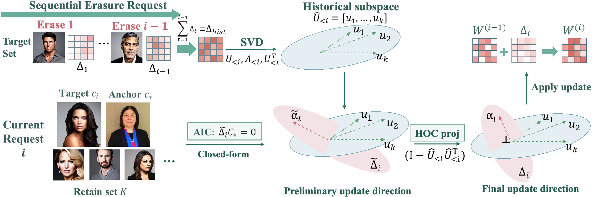

# CEASE

**Continual Concept Erasure in Diffusion Models by Suppressing Cross-Edit Interference**

Yongliang Wu, Haori Lu, Jinqi Luo, Wei Cao, Xingyu Zhu, Yaoyao Liu

[Project page](https://continual-erasure.cvmlgroup.web.illinois.edu/)



CEASE removes concepts sequentially from text-to-image diffusion models without training. It imposes two subspace constraints on the closed-form cross-attention solver of SPEED:

- **Anchor Invariance Constraint (AIC), Eq. 9.** The token representation of the shared anchor is appended to the solver's invariance matrix K2, so every update leaves the anchor unchanged.
- **Historical Orthogonality Constraint (HOC), Eq. 12–14.** When the cumulative past update already perturbs the current target substantially, the new update is projected onto the orthogonal complement of the dominant left singular directions of the cumulative past update.

Across sequences of 100 edits on celebrities, artistic styles, and instances (Stable Diffusion v1.4, v1.5, and v2.1), CEASE reduces accumulated interference while preserving unrelated generations.

## Repository layout

```
cease_edit.py        one closed-form erasure step: base solver (Eq. 1) + AIC (Eq. 9)
cease_sequential.py  continual erasure loop (Eq. 2) + HOC (Eq. 12-14) + update-noise diagnostic (Eq. 4); entry point
sample.py            image sampling from the original and edited model
concept_utils.py     concept-list loading
src/                 seeding helpers and the five prompt templates per task
data/                concept lists: 100_celebrity.csv, style.csv, instance.csv
```

`data/100_celebrity.csv` lists 100 erased and 100 retained celebrities, each with five prompts and a sampling seed. `data/style.csv` and `data/instance.csv` are ordered lists; the first 100 concepts are erased and the next 100 are retained.

## Setup

```bash
conda create -n cease -y python=3.10
conda activate cease
pip install -r requirements.txt
```

The default backbone is `CompVis/stable-diffusion-v1-4`. Pass `--sd_ckpt` to use a local copy or another backbone; Stable Diffusion v1.5 and v2.1 use the same commands.

## Continual erasure

Each command erases 100 concepts one request at a time on top of all previous edits, with the 100 retained concepts as the fixed retain set. The per-task anchors are `person`, `art`, and `object`.

```bash
# Celebrities
python cease_sequential.py --task celebrity --retain_path data/100_celebrity.csv \
    --anchor person --n_concepts 100 --aic --hoc \
    --save_root logs/cease/celebrity --save_ckpt_every 100

# Artistic styles
python cease_sequential.py --task style --retain_path data/style.csv \
    --anchor art --n_concepts 100 --aic --hoc \
    --save_root logs/cease/style --save_ckpt_every 100

# Instances
python cease_sequential.py --task instance --retain_path data/instance.csv \
    --anchor object --n_concepts 100 --aic --hoc \
    --save_root logs/cease/instance --save_ckpt_every 100
```

Each run writes `checkpoints/step_XXX.pt` (edited value-projection weights), `metrics.json` (the per-step update-noise diagnostic of Eq. 4 on the erased targets and the retain set), `k_bank.pt`, `delta_cum_final.pt`, and `run_config.json`.

### Ablations

**AIC and HOC.** Use the same commands with a subset of the two flags:

| Variant          | Flags          |
|------------------|----------------|
| SPEED, continual | none           |
| HOC only         | `--hoc`        |
| AIC only         | `--aic`        |
| CEASE            | `--aic --hoc`  |

**Layer scope.** `--layer_scope` selects the edited cross-attention stages: `all` (default), `mid`, `fine` (high resolution), or `coarse` (low resolution).

**Erasure order.** `--order_seed <int>` permutes the erasure order with the given seed.

**Interference curves.** `--save_ckpt_every 5` keeps intermediate checkpoints.

## Hyperparameters

The defaults of `cease_sequential.py` are the values used in the paper.

| Parameter                              | Value | Flag               |
|----------------------------------------|-------|--------------------|
| Edited projections                     | value | `--params V`       |
| Near-null projector threshold τ        | 0.1   | `--threshold`      |
| Retain scale                           | 0.05  | `--retain_scale`   |
| Invariance regularizer λ               | 0     | `--lamb`           |
| Augmented retain samples per concept   | 10    | `--aug_num`        |
| Importance-based retain filter         | off   | `--disable_filter` |
| HOC statistic, EMA coefficient         | 0.9   | `--hoc_ema`        |
| HOC trigger: mean + η · std            | 1.5   | `--hoc_eta`        |
| HOC max fraction of removed dimensions | 0.75  | `--hoc_keep_frac`  |

## Sampling

All sampling uses FP16, DPM-Solver with 20 steps, and classifier-free guidance 7.5, with five prompts per concept.

```bash
# Celebrities: prompts and seeds from the csv, one image per prompt
python sample.py --task celebrity --prompt_csv data/100_celebrity.csv \
    --mode original,edit --edit_ckpt logs/cease/celebrity/checkpoints/step_100.pt \
    --save_root outputs/celebrity

# Styles / instances: five templates per concept, five images per prompt, seed 0
python sample.py --task style --concepts_csv data/style.csv --concept_limit 200 \
    --num_samples 5 --batch_size 5 --mode original,edit \
    --edit_ckpt logs/cease/style/checkpoints/step_100.pt --save_root outputs/style
```

Images are written to `<save_root>/<concept>/{original,edit}/`.

## Acknowledgements

The closed-form solver builds on the public [SPEED](https://github.com/Ouxiang-Li/SPEED) implementation.

## License

Released under the Apache License 2.0. See [LICENSE](LICENSE).
